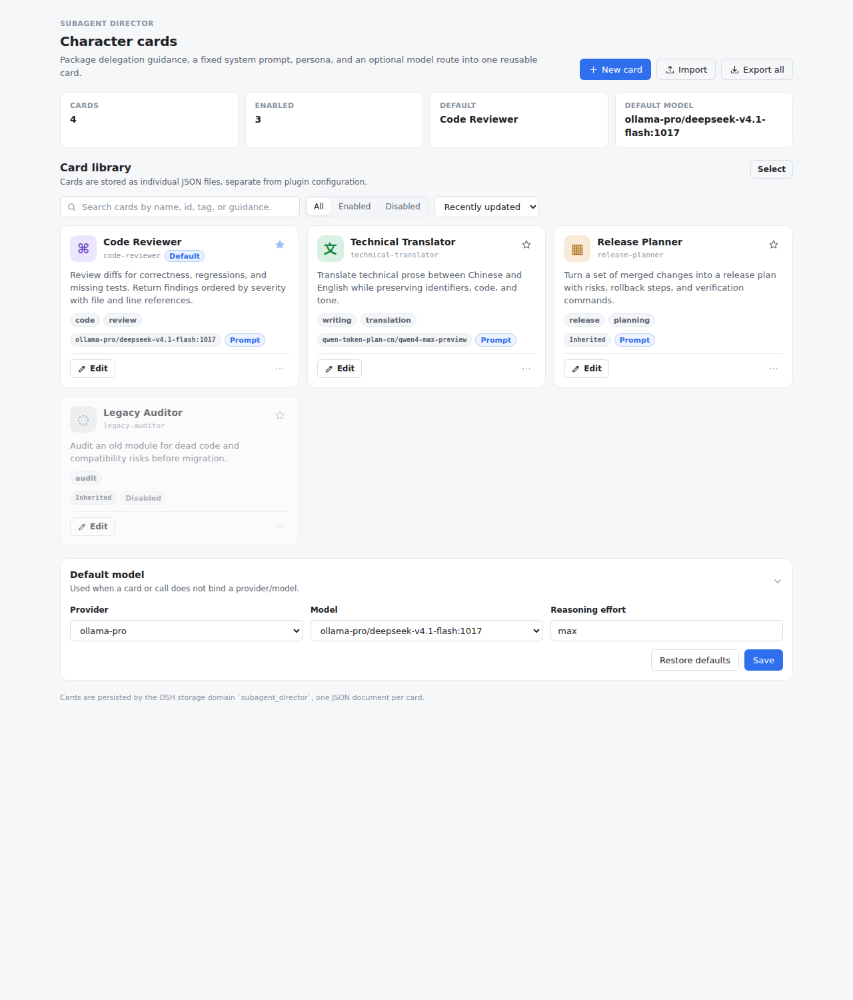
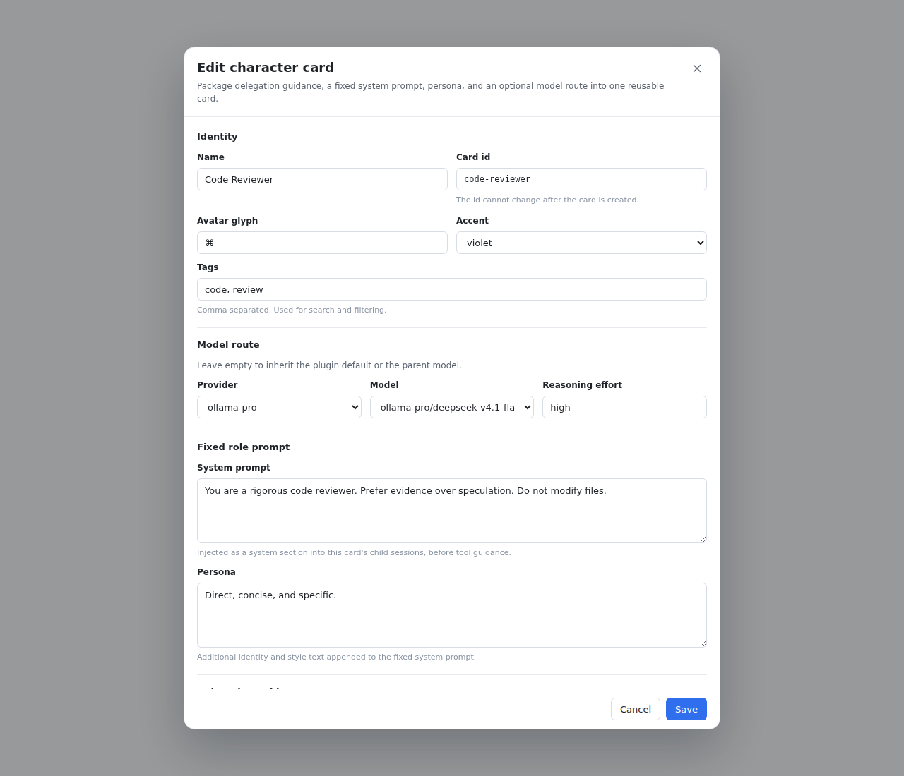

<div align="center">

# 🎬 Subagent Director

**Assign an LLM provider and model to DeepSeek Harness subagents, and package fixed prompts and delegation intent with character cards**

[](https://www.npmjs.com/package/dsh-plugin-subagent-director)
[](https://www.npmjs.com/package/dsh-plugin-subagent-director)
[](LICENSE)
[](package.json)
[](https://github.com/SeverusZh/dsh-plugin-subagent-director/releases)
[](https://github.com/SeverusZh/dsh-plugin-subagent-director)
[](https://github.com/deepseek-ai/deepseek-harness)
[](https://awesome-dsh-plugin.com)

</div>

**Subagent Director** is an out-of-tree DeepSeek Harness plugin that lets you choose an LLM provider and model for subagents, and package fixed system prompts, personas, and delegation intent as character cards.

> **Latest release 0.8.0**: [npm](https://www.npmjs.com/package/dsh-plugin-subagent-director/v/0.8.0) · [GitHub Release](https://github.com/SeverusZh/dsh-plugin-subagent-director/releases/tag/v0.8.0)

---

## ✨ 功能特性 / Features

- **Provider/model selection** — a configurable default LLM provider (route) and model for subagents; each delegation can also specify `provider` / `model` explicitly from the model side;
- **Controlled model selection** — provider/model are chosen only from the official `subagent-model-selection` allowlist (`allowedModels`): an explicitly passed unauthorized route is a hard error, while unauthorized routes at the plugin-default / card-binding layer are dropped and fall back to inheritance (no double-writing of model routes with the official dsh-tool-subagent);
- **Hot configuration reload** — changes in settings.yaml / the plugin config page take effect immediately, no restart needed;
- **Character cards** — each card packages a name, model binding, fixed system prompt, persona, delegation guidance, tags, and an optional Agent Preset; one JSON file per card, independent of the plugin's public configuration;
- **Fixed role prompt** — the child session receives the card's fixed system prompt and persona; a running child keeps the snapshot it started with, so editing a card never rewrites it;
- **Import, export, batch** — single or batch JSON import/export with skip/overwrite/keep-both conflict policies, plus batch enable, disable, delete, and export;
- **Legacy role migration** — one action converts the old `roles` into cards while preserving the default role, persona, and model binding; legacy tool-set data is kept as a note;
- **Four-layer fallback chain** — per-call args > card binding > plugin default > inherit from the parent agent (zero intrusion when unconfigured);
- **Main-agent guidance** — the system prompt auto-injects the card list, so the main agent knows when to delegate to whom;
- **Config UI** — a modern card library inside the plugin detail page (plugin list → dsh-plugin-subagent-director): search, filters, selection, card editor, import/export, and migration; light and dark themes, and the settings panel no longer hosts this plugin's configuration;
- **Continuable background** — returns a durable subagent id for ongoing delegation with send_message;
- **Release continuable children** — a model-facing `close_subagent(subagent_id)` tool plus a "terminate continuable state" button on the subagent session page, releasing continuable subagents started by this plugin whose activation receipt is retained; this covers only the current process and activation, and a later send_message cold resume creates a new untracked activation; since DSH 0.2.2 the host no longer exposes a public per-child close API;
- **Observability** — when a subagent session is opened, its actual provider/model is shown below the composer (the real route is read from the session's `request/header` records; graceful degradation when unavailable);

## 📦 安装 / Install

### Install

```bash
dsh plugin --profile <name> add dsh-plugin-subagent-director
```

Or, for local development, mount a local checkout with `dsh plugin --profile <name> add link:<absolute path>`
(see the configuration example below).

### Installation notes

- Prefer `dsh plugin --profile <name> add dsh-plugin-subagent-director` directly (the npm
  release already includes the build output; peer dependencies are provided by DSH's
  `$DSH_HOME/profiles/node_modules` fallback, so it works out of the box).
- For local `link:` development: the git repo does not contain `lib/` (it is .gitignore'd),
  so run `npm install && npm run build` before mounting; and the checkout must live under
  `$DSH_HOME/profiles/` (or the repo must carry its own node_modules), otherwise the
  `@deepseek-ai/*` peer dependencies fail with `ERR_MODULE_NOT_FOUND`.

## 🚀 快速开始 / Quick Start

Create a card on the plugin page first (for example `code-reviewer`), then delegate:

```text
subagent_role({ role: "code-reviewer", prompt: "Review this change" })
subagent_role({ role: "translator", prompt: "Translate README.md into English" })
```

The `role` argument is the character-card id; when it misses an id it is matched exactly by
the card name (the first of same-named cards in definition order is used, with a notice).
Using ids is recommended, see the Delegate line in the system prompt.

> **`subagent_role` and the built-in `subagent` are two different tools.** This plugin
> registers `subagent_role` (the tool name comes from the `toolName` config, `subagent_role`
> by default); the DSH base bundle also ships the built-in `subagent` / `subagent_fork`, and
> both appear **side by side** in the tool list of the same request. Only calls through
> `subagent_role` applies the card's fixed system prompt, persona, model binding, and optional
> `agentPreset`; switching to the built-in `subagent` disables all of them (model selection is
> handled by the official dsh-tool-subagent's `modelSelectionSettings`).
> So when role semantics are needed, explicitly ask in the prompt to call `subagent_role`.

## 🖼️ 界面预览 / Screenshots

The screenshot below comes from a throwaway local preview instance; the example data is for demonstration only:





## ⚙️ 配置 / Configuration

`dsh plugin add` auto-mounts the main and bridge entries (via the `cordis.patch.yml` shipped
with the package — `subagent-director` / `subagent-director-bridge`; the bridge entry exposes
the settings namespace to the Web UI), so you do **not** `insert` them manually. To override
the default configuration, override the main entry by id:

```yaml
- id: subagent-director
  name: dsh-plugin-subagent-director
  config:
    subagentProvider: spawn      # 传输：spawn（无父上下文）/ fork（继承父历史）
    toolName: subagent_role      # 本插件注册的模型可见工具名（不是内置 subagent）
    enableRunInBackground: true
    backgroundMode: one-shot     # one-shot 或 continuable
    maxDepth: 3
```

> Note: do not add these two entries with `- insert:` again, or startup fails with
> `duplicate loader entry id`.

Character cards are **not** stored in the configuration above: they live in the DSH storage
domain `subagent_director`, one JSON document per card (by default under
`<storage-root>/subagent_director/cards/<id>.json`). `roles` / `defaultRole` remain only as a
migration source for older data.

## 🎭 角色卡 / Character Cards

A character card is an independent delegation unit: it carries the delegation guidance the
main agent reads and the fixed role prompt the child session receives. Core fields:

- `id` / `name` / `emoji` / `accent` / `tags`: identity and presentation;
- `model`: optional `{ provider, model, reasoningEffort }` route; empty inherits the plugin default or the parent model;
- `systemPrompt`: fixed system prompt injected into the child session;
- `persona`: identity and style text appended after the system prompt;
- `delegationGuidance`: guidance shown to the main agent;
- `agentPreset`: optional DSH Agent Preset for tool composition;
- `enabled` / `notes` / `createdAt` / `updatedAt`: state and human-only information.

Cards are saved as per-record JSON and can be imported or exported one at a time or in bulk.
Example collection:

```json
{
  "kind": "subagent-director/character-card-collection",
  "version": 1,
  "exportedAt": "2026-11-27T00:00:00.000Z",
  "cards": [
    {
      "id": "code-reviewer",
      "name": "Code Reviewer",
      "delegationGuidance": "Review diffs for correctness and regressions.",
      "systemPrompt": "You are a rigorous code reviewer.",
      "model": { "provider": "ollama-pro", "model": "deepseek-v4.1-flash:1017" },
      "tags": ["code", "review"]
    }
  ]
}
```

Import accepts a single card, a collection, an array, or a bare card object. When an id
already exists you can skip, overwrite, or keep both. The old `roles` can be migrated from
the same page; clearing the legacy settings fields is recommended after migration. See
[docs/character-cards.md](docs/character-cards.md) for fields and storage details.

## 🎼 纯编排模式 / Orchestrate Mode

```text
/orchestrate 分析上周A股走势   # 本轮开启并直接编排该任务（推荐用法）
/orchestrate                  # 本轮开启（按轮生效，无需 on/off）
/orchestrate on               # 持久开启（直到 /orchestrate off）
/orchestrate off              # 退出持久模式
```

Declare `/orchestrate` at the start of a message (optionally followed by the task text, e.g.
`/orchestrate 分析上周A股走势`), or write "use orchestrate mode" in natural language (including
variants such as "请使用 orchestrate 模式" and "use orchestrate mode"), and that turn
automatically enters pure-orchestration mode — a per-turn declarative usage similar to
`/using aegis`, with no need to remember a toggle state; without the declaration, normal mode
is kept. `/orchestrate <task>` queues the task text into the next turn and wakes the model,
which handles the task in pure-orchestration mode. Once enabled, a "pure orchestrator" system
prompt is injected: the main agent may only hand out work through delegation tools, and the
card list is rendered dynamically from the current card library while remaining compatible
with unmigrated `roles` (no hard-coded role ids). **When no cards are configured**, the binding
pure-orchestration framework is not injected; instead a short prompt tells the model to state
that a card must be created first and to continue handling the request in normal mode
(avoiding "no output in the conversation").
This mode depends on the host's `commands` and `sessionProjections` services: standard profiles
(dsh-base) provide both; when `sessionProjections` is missing the command returns an explicit
error instead of pretending to succeed, and when `commands` is missing the command is simply
not registered and the rest of the plugin is unaffected.

## 🧭 与官方子代理选择器的适配 / Official Subagent Selector Adaptation

Since DSH alpha.4, the built-in subagent's model selection converges on the official `subagent-model-selection` settings section (the `allowedModels` allowlist). This plugin v0.5.0 fully adapts to that mechanism:

- **Select only from the allowlist** — `route-resolver` constrains provider/model to the
  official `subagent-model-selection.allowedModels`: an explicitly passed unauthorized route is
  a **hard error**; unauthorized routes at the plugin-default / card-binding layer are
  **dropped and fall back to inherit from the main agent**;
- **No more double-writing of model routes** — the rc-era `applyDefaultRoute` patch seam is
  removed, so the plugin and the official selector never overwrite the same route
  (the provider/model selectable in the settings panel are exactly the options in the official
  "Plugins → plugin config → Subagent pool");
- **Client half migrated in step** — all rc-era references to
  `@deepseek-ai/dsh-client-runtime/client` (the `dsh-client-runtime` package) are removed
  (neither the alpha.4 nor alpha.5 host carries that package); the dock reading now reads the
  alpha.4 session `request/header` records, and the config page loads normally on both alpha.4
  and alpha.5 hosts.

## 📖 术语 / Glossary

- **Character card**: a portable delegation unit, independent of the plugin's public configuration;
- **subagentProvider (transport)**: `spawn` / `fork` / `acp` — which transport link the subagent runs on;
- **provider (LLM route)**: `deepseek-official`, pi-ai route — which provider the model request is actually sent to;
- **Storage domain**: the DSH `storageDomain` facility; this plugin uses the `subagent_director` domain and stores cards per record.

The first two are **two separate namespaces**; do not confuse them when configuring.

## 🧩 兼容性 / Compatibility

Since DSH 0.2.1 the compatibility gate prefers `engines.dsh`. This plugin declares **`engines.dsh: ">=0.2.2-rc.2"`**, and every `@deepseek-ai/dsh-*` peer is likewise `>=0.2.2-rc.2`:

| DSH version | Status |
| --- | --- |
| 0.2.2-rc.5 | ✅ typecheck / 357 tests / build (runtime not re-verified here) |
| 0.2.3-alpha.2 | ✅ typecheck / 357 tests / build / real Cordis probes |

> Only versions that were **actually run** are listed; untested versions are omitted.

v0.7.0 targets DSH **0.2.2-rc.2+** and fixes the delegation crash caused by the 0.2.2 flat activation spec and the broken close path after `drainChildren` removal. **Breaking**: DSH 0.2.1-rc.x / 0.2.2-rc.1 users should stay on plugin **0.6.0**.

## 🛠️ 开发 / Develop

```bash
npm install
npm test          # vitest (357 tests)
npm run typecheck
npm run build     # host(tsc) + client(rolldown bundle)
```

## ❓ FAQ

**Why are two plugin entries needed?**
DSH's Web API only opens read/write to a whitelisted set of settings namespaces. This plugin bridges its own namespace through a self-registered `/subagent-director` HTTP route, and the webServer service that route depends on can only be obtained via cordis `inject`, so it is split into a separate `subagent-director-bridge` entry (in a headless environment without Web it simply does not activate, and the main entry is unaffected).

**What happens when no character cards are configured?**
With no cards and no default model configured it behaves exactly as if the plugin were not installed (zero intrusion). With `defaultProvider`/`defaultModel` configured: if the official `subagent-model-selection` is enabled and has an `allowedModels` allowlist, the default route takes effect only within that list (otherwise it is dropped and falls back to inheritance); if no allowlist is configured, the plugin's default behavior is kept and a warning is shown.

**Can a session that used `/orchestrate` still be opened after uninstalling the plugin?**
No. `/orchestrate` writes an `orchestrate/change` event into the session log, and the host's persistence-load validation rejects loading the entire log when it meets an event type that is "unknown and not marked ignorable" (to avoid misreading the log's semantics). The plugin registers that event type dynamically when mounted, so normal use is unaffected; but in an environment where this plugin is not mounted (after uninstall, or another profile) these sessions cannot be opened. Upstream does not yet provide an official registration API or an `ignorable` write API for third-party event types — a known trade-off, see [issue #6](https://github.com/SeverusZh/dsh-plugin-subagent-director/issues/6).

**Do new providers/APIs appear automatically?**
Yes. The config page subscribes to provider and settings change events; after you add a provider/API key on the Models page, the dropdown refreshes automatically, with no restart.

## 📄 许可证 / License

[MIT](./LICENSE) © Subagent Director contributors
