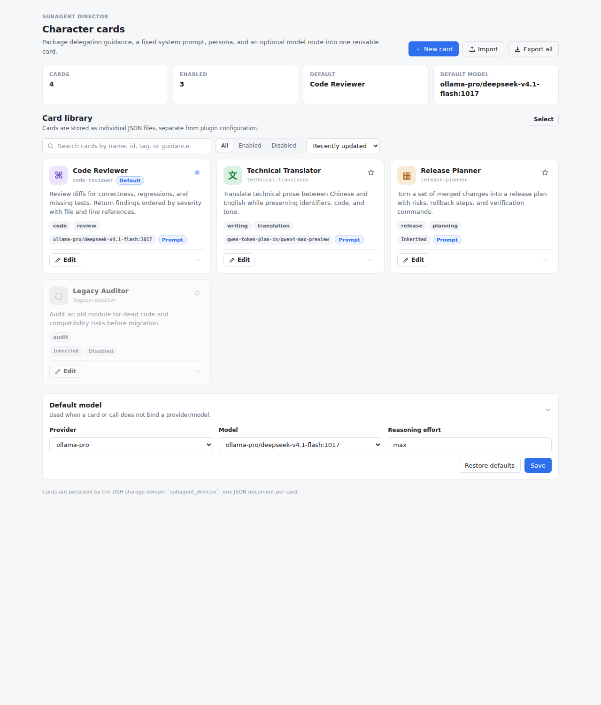
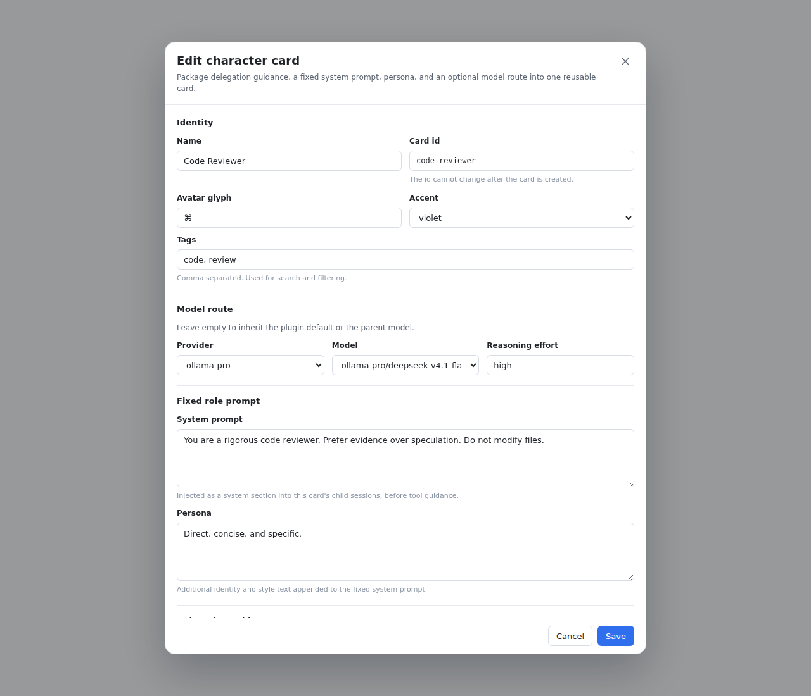

<div align="center">

# 🎬 Subagent Director 子代理导演

**为 DeepSeek Harness 的 subagent 指定 LLM 供应商与模型，并用「角色卡」打包固定提示词与委派分工**

[](https://www.npmjs.com/package/dsh-plugin-subagent-director)
[](https://www.npmjs.com/package/dsh-plugin-subagent-director)
[](LICENSE)
[](package.json)
[](https://github.com/SeverusZh/dsh-plugin-subagent-director/releases)
[](https://github.com/SeverusZh/dsh-plugin-subagent-director)
[](https://github.com/deepseek-ai/deepseek-harness)
[](https://awesome-dsh-plugin.com)

</div>

**Subagent Director** 是一个 out-of-tree 的 DeepSeek Harness 插件，用于为 subagent 指定 LLM 供应商与模型，并通过「角色卡」打包固定系统提示词、persona 与委派分工。

> **最新发布 0.8.0**：[npm](https://www.npmjs.com/package/dsh-plugin-subagent-director/v/0.8.0) · [GitHub Release](https://github.com/SeverusZh/dsh-plugin-subagent-director/releases/tag/v0.8.0)

---

## ✨ 功能特性 / Features

- **供应商与模型选择** —— 为 subagent 配置默认 LLM 供应商（route）与模型；每次委派也可以由模型显式指定 `provider` / `model`；
- **受控的模型选择** —— provider/model 只从官方 `subagent-model-selection` 授权列表
  （`allowedModels`）中选择：显式传入未授权路由为硬错误，角色/默认层未授权路由被
  丢弃并回退继承（不与官方 dsh-tool-subagent 双重写模型路由）；
- **配置热更新** —— settings.yaml / 插件配置页的改动即时生效，无需重启；
- **角色卡** —— 每张卡打包名称、模型绑定、固定系统提示词、persona、委派指引、标签与可选 Agent Preset；一张卡一个 JSON 文件，独立于插件公共配置；
- **固定角色提示词** —— 委派时为该子会话注入固定系统提示词与 persona；运行中的子代理保持启动时的提示词快照，编辑卡片不会改写它；
- **导入导出与批量操作** —— 单卡或批量 JSON 导入导出、跳过/覆盖/保留两者冲突策略，批量启用、停用、删除与导出；
- **旧角色迁移** —— 一键把旧版 `roles` 转为角色卡，保留默认角色、persona 与模型绑定，旧工具集信息转为备注；
- **四级回退链** —— 单次调用参数 > 角色卡绑定 > 插件默认 > 继承主代理（未配置时零侵入）；
- **主代理指引** —— 系统提示自动注入角色卡清单，主代理知道何时委派给谁；
- **配置界面** —— 插件详情页内现代卡片库（插件列表 → dsh-plugin-subagent-director）：搜索、筛选、批量、卡片编辑器、导入导出与迁移；亮暗主题通用，设置面板不再承载本插件配置；
- **continuable 后台** —— 返回可续聊子代理 id，配合 send_message 持续委派；
- **释放可持续子代理** —— 模型可见工具 `close_subagent(subagent_id)` 与子代理会话
  页的「终止可持续状态」按钮，释放本插件启动并保留 activation 凭证的 continuable
  子代理；只覆盖当前进程与当前 activation，send_message 冷恢复后的新 activation 不再跟踪；
  DSH 0.2.2 起宿主不再提供按 id 关闭任意子代理的公开 API；
- **可观测性** —— 打开子代理会话时，composer 下方显示其实际运行的供应商/模型
  （从会话 `request/header` 记录读取真实路由；读不到时优雅降级）；

## 📦 安装 / Install

### 安装

```bash
dsh plugin --profile <name> add dsh-plugin-subagent-director
```

或本地开发时以 `dsh plugin --profile <name> add link:<绝对路径>` 挂载本地 checkout
（配置示例见下）。

### 安装注意事项

- 推荐直接 `dsh plugin --profile <name> add dsh-plugin-subagent-director`（npm
  发布版已包含构建产物，peer 依赖由 DSH 的 `$DSH_HOME/profiles/node_modules`
  fallback 提供，开箱即用）。
- 本地 `link:` 开发时：git 仓库不包含 `lib/`（已被 .gitignore），挂载前需先
  `npm install && npm run build`；且 checkout 需位于 `$DSH_HOME/profiles/` 下
  （或仓库自带 node_modules），否则 `@deepseek-ai/*` peer 依赖会报
  `ERR_MODULE_NOT_FOUND`。

## 🚀 快速开始 / Quick Start

先在插件页创建角色卡（例如 `code-reviewer`），再在对话中委派：

```text
subagent_role({ role: "code-reviewer", prompt: "审查这次改动" })
subagent_role({ role: "translator", prompt: "把 README.md 翻译成英文" })
```

`role` 参数是角色卡 id；未命中 id 时会按卡片名称精确匹配（多个同名卡取定义顺序
第一个并提示）。建议始终用 id，见系统提示中的 Delegate 行。

> **`subagent_role` 与内置 `subagent` 是两个不同的工具。** 本插件注册的是
> `subagent_role`（工具名由 `toolName` 配置，默认 `subagent_role`）；DSH 基础
> bundle 另有内置的 `subagent` / `subagent_fork`，两者在同一次请求的工具清单里
> **并存**。只有走 `subagent_role` 才会应用角色卡的固定系统提示词、persona、模型绑定与可选
> `agentPreset`；模型改用内置 `subagent` 时这些都不生效（模型选择由官方
> dsh-tool-subagent 的 `modelSelectionSettings` 负责）。
> 因此需要角色语义时，请在提示里明确要求调用 `subagent_role`。

## 🖼️ 界面预览 / Screenshots

以下截图来自本地一次性预览实例，示例数据仅用于演示：





## ⚙️ 配置 / Configuration

`dsh plugin add` 会通过插件包自带的 `cordis.patch.yml` 自动挂载主条目与桥接条目
（`subagent-director` / `subagent-director-bridge`，桥接条目用于把设置命名空间
暴露给 Web UI），**不需要**手动 `insert`。需要覆盖默认配置时按 id 覆盖主条目：

```yaml
- id: subagent-director
  name: dsh-plugin-subagent-director
  config:
    subagentProvider: spawn      # 传输：spawn（无父上下文）/ fork（继承父历史）
    toolName: subagent_role      # 本插件注册的模型可见工具名（不是内置 subagent）
    enableRunInBackground: true
    backgroundMode: one-shot     # one-shot 或 continuable
    maxDepth: 3
```

> 注意：不要再用 `- insert:` 添加这两个条目，否则启动会报
> `duplicate loader entry id`。

角色卡数据**不在**上述配置中：它由 DSH 存储域 `subagent_director` 持久化，每张卡
一个 JSON 文档（默认位于 `<storage-root>/subagent_director/cards/<id>.json`）。
配置中的 `roles` / `defaultRole` 仅作为旧数据迁移来源保留。

## 🎭 角色卡 / Character Cards

角色卡是独立的委派单元，包含主代理可见的委派指引，以及子代理运行时的固定角色
提示词。核心字段：

- `id` / `name` / `emoji` / `accent` / `tags`：身份与展示；
- `model`：可选的 `{ provider, model, reasoningEffort }` 路由，留空继承插件默认或父代理；
- `systemPrompt`：注入子代理会话的固定系统提示词；
- `persona`：追加在系统提示词之后的身份与风格文本；
- `delegationGuidance`：给主代理看的委派指引；
- `agentPreset`：可选的 DSH Agent Preset，用于工具组合；
- `enabled` / `notes` / `createdAt` / `updatedAt`：状态与人读信息。

卡片以 per-record JSON 保存，可单张或批量导入导出。导出集合示例：

```json
{
  "kind": "subagent-director/character-card-collection",
  "version": 1,
  "exportedAt": "2026-11-27T00:00:00.000Z",
  "cards": [
    {
      "id": "code-reviewer",
      "name": "Code Reviewer",
      "delegationGuidance": "Review diffs for correctness and regressions.",
      "systemPrompt": "You are a rigorous code reviewer.",
      "model": { "provider": "ollama-pro", "model": "deepseek-v4.1-flash:1017" },
      "tags": ["code", "review"]
    }
  ]
}
```

导入支持单卡、集合、数组或裸卡片对象；冲突时可跳过、覆盖或保留两者。旧版
`roles` 可从同一页面一键迁移，迁移后建议勾选清除旧配置字段。字段与存储格式见
[docs/character-cards.md](docs/character-cards.md)。

## 🎼 纯编排模式 / Orchestrate Mode

```text
/orchestrate 分析上周A股走势   # 本轮开启并直接编排该任务（推荐用法）
/orchestrate                  # 本轮开启（按轮生效，无需 on/off）
/orchestrate on               # 持久开启（直到 /orchestrate off）
/orchestrate off              # 退出持久模式
```

在消息开头声明 `/orchestrate`（可后接任务文本，如 `/orchestrate 分析上周A股走势`），
或用自然语言写「使用orchestrate模式」（含「请使用 orchestrate 模式」「use
orchestrate mode」等变体），该轮会话即自动进入纯编排模式——类似 `/using aegis`
的按轮声明式用法，无需记忆开关状态；未声明时保持普通模式。`/orchestrate <任务>`
会把任务文本排入下一轮并唤醒模型，该轮以纯编排模式处理任务。开启后注入一段
「纯编排者」系统提示：主代理只允许通过委派工具派活，角色卡清单从当前
卡片库动态渲染，并兼容尚未迁移的旧 `roles`（无硬编码 role id）。**未配置任何
角色卡时**不会注入束缚性的纯编排框架，而是注入一段简短提示，让模型明确告知需要
先创建角色卡并继续以普通模式处理请求（避免「对话无输出」）。该模式依赖宿主的 `commands` 与
`sessionProjections` 服务：标准 profile（dsh-base）都会提供二者；
`sessionProjections` 缺失时命令返回明确错误而不是假装成功，`commands` 缺失时
命令不注册，插件其余功能不受影响。

## 🧭 与官方子代理选择器的适配 / Official Subagent Selector Adaptation

DSH alpha.4 起，官方内置 subagent 的模型选择收敛到 `subagent-model-selection` 设置段（`allowedModels` 授权列表）。本插件 v0.5.0 完全适配该机制：

- **只从授权列表选择** —— `route-resolver` 把 provider/model 约束在官方
  `subagent-model-selection.allowedModels` 内：显式传入未授权路由为**硬错误**；
  插件默认层 / 角色卡绑定层的未授权路由被**丢弃并回退继承主代理**；
- **不再双重写模型路由** —— 移除 rc 时代的 `applyDefaultRoute` 补丁缝，插件与
  官方选择器不会各自覆盖同一条路由（设置面板可选的 provider/model 即官方
  「插件-插件配置-Subagent池」里的选项）；
- **客户端半同步移植** —— 移除 rc 时代对 `@deepseek-ai/dsh-client-runtime/client`
  （`dsh-client-runtime` 包）的全部引用（alpha.4/alpha.5 宿主均不携带该包），dock 读数改读 alpha.4 会话
  `request/header` 记录，配置页在 alpha.4/alpha.5 宿主均可正常加载。

## 📖 术语 / Glossary

- **角色卡**：可导入导出的委派单元，独立于插件公共配置；
- **subagentProvider（传输）**：`spawn` / `fork` / `acp`——子代理跑在哪条传输链路上；
- **provider（LLM route）**：`deepseek-official`、pi-ai route——模型请求实际发给哪个供应商；
- **存储域**：DSH 的 `storageDomain` 设施；本插件使用 `subagent_director` 域，按记录保存卡片。

前两者是**两套命名空间**，配置时不要混淆。

## 🧩 兼容性 / Compatibility

DSH 0.2.1 起兼容门禁优先读取 `engines.dsh`。本插件声明 **`engines.dsh: ">=0.2.2-rc.2"`**，全部 `@deepseek-ai/dsh-*` peer 也收敛到 `>=0.2.2-rc.2`：

| DSH 版本 | 状态 |
| --- | --- |
| 0.2.2-rc.5 | ✅ typecheck / 357 测试 / 构建（运行时未在本机复验） |
| 0.2.3-alpha.2 | ✅ typecheck / 357 测试 / 构建 / 真实 Cordis 探针 |

> 只列出**实际跑过**的版本；未实测的不列。

v0.7.0 支持 DSH **0.2.2-rc.2+**，修复 0.2.2 扁平 activation spec 导致的委派崩溃与 `drainChildren` 移除后的关闭失效。**破坏性**：0.2.1-rc.x / 0.2.2-rc.1 请停留在插件 **0.6.0**。

## 🛠️ 开发 / Develop

```bash
npm install
npm test          # vitest（357 用例）
npm run typecheck
npm run build     # host(tsc) + client(rolldown bundle)
```

## ❓ FAQ

**为什么需要两个插件条目？**
DSH 的 Web API 只向白名单内的 settings 命名空间开放读写。本插件通过自注册的 `/subagent-director` HTTP 路由桥接自己的命名空间，而该路由依赖的 webServer 服务只能经 cordis `inject` 获取，因此拆成独立的 `subagent-director-bridge` 条目（无 Web 的 headless 场景它会自动不激活，主条目不受影响）。

**放在反向代理/网关后面，设置页提示「此服务器尚未提供设置桥接通道」怎么办？**
桥接路由默认只接受回环 Host（`localhost`、`127.0.0.0/8`、`[::1]`），避免设置写在无人看守的公网上裸奔。经反向代理用域名访问时 Host 不是回环地址，请求被 403 拒绝，而前端把任何失败都渲染成上面那句提示，看不出真实原因。把该域名加进白名单即可（端口与大小写不敏感）。

优先在 `config.yaml` 里配置桥接条目：

```yaml
- id: subagent-director-bridge
  name: dsh-plugin-subagent-director/bridge
  config:
    trustedHosts:
      - dsh.example.com
```

旧的逗号分隔环境变量仍保留作 fallback，与 Config 取并集：

```bash
DSH_SUBAGENT_DIRECTOR_TRUSTED_HOSTS=dsh.example.com
```

不配置时行为与之前完全一致（依旧只认回环）；白名单只解除这一层围栏，域名仍需通过你自己的认证层。

**未配置任何角色卡时行为如何？**
未配置任何角色卡且未配置默认模型时与未安装本插件完全一致（零侵入）。配置了
`defaultProvider`/`defaultModel` 时：若官方 `subagent-model-selection` 已启用并有
`allowedModels` 授权列表，默认路由仅在该列表内才生效（否则被丢弃并回退继承）；若
未配置授权列表，则保留插件默认行为并给出警告提示。

**用过 `/orchestrate` 的会话，卸载插件后还能打开吗？**
不能。`/orchestrate` 会在会话日志写入 `orchestrate/change` 事件，而宿主的持久化
加载校验遇到「未知且未标记 ignorable」的事件类型时会拒绝加载整个日志（避免误解
日志语义）。插件挂载时会动态注册该事件类型，正常使用不受影响；但在未挂载本插件
的环境（卸载后、其他 profile）中，这些会话将无法打开。上游暂未提供第三方事件
类型的官方注册或 `ignorable` 写入 API，此为已知取舍，详见
[issue #6](https://github.com/SeverusZh/dsh-plugin-subagent-director/issues/6)。

**新供应商/API 会自动出现吗？**
会。配置页订阅了供应商与设置变更事件，在 Models 页新增供应商/API key 后，下拉列表自动刷新，无需重启。

## 📄 许可证 / License

[MIT](./LICENSE) © Subagent Director contributors
